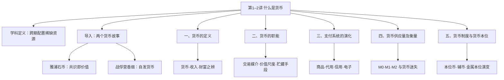
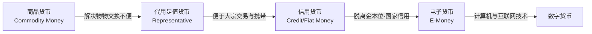
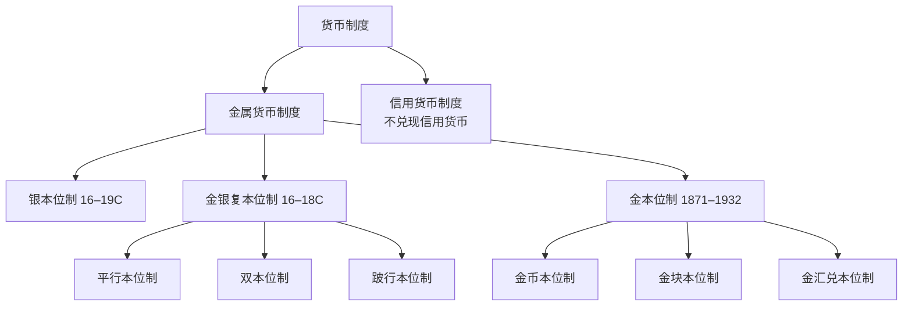

# 金融学 · 第1–2讲：什么是货币

> [!info] 本讲脉络
> 第 1 讲只用一句话界定了学科，内容并入本讲开头；第 2 讲围绕货币展开五个问题——货币**是什么**（定义）、**为什么**需要它（职能）、形态**如何演变**（支付系统）、**如何衡量**（货币供应量）、信任**由谁保障**（货币制度）。其中第五部分“货币制度”课堂未及展开，本笔记依据课件补全。

## 学科定义（第1讲）

> [!quote] Finance 的定义
> Finance as a scientific discipline is the study of how to allocate scarce resources over time under conditions of uncertainty.
> 金融学作为一门科学，研究的是**在不确定条件下，如何跨时间配置稀缺资源**。

跨时间、跨空间配置资金与管理风险，离不开一个最基础的工具——货币。于是第 2 讲从“货币是什么”开始。

## 导入：两个货币故事（Money Stories）

### 故事一：雅浦岛石币（Yap Stone Money）

- 南太平洋雅浦岛居民使用**中间有孔的巨大石灰岩石盘**作货币，很多石币体积巨大、根本无法移动。
- 交易发生时，岛民**不移动石币本身**，而是通过公开宣告、社群共识来转移所有权——交易只需“做记号”。
- 最著名的一块石币在运输途中遭遇暴风雨、沉入海底，却丝毫不影响它的价值：**它存在于所有人的共识里**，所有人都认可这笔财富的归属。

### 故事二：二战战俘营里的香烟货币

- 二战战俘营中，红十字会提供食物、衣服、香烟等物资，**香烟脱颖而出成为通用货币**：用来交换物品、支付赌债、衡量其他货物价值。
- 香烟价值稳定到这样的程度：当红十字会**停止供应**香烟时，整个营地出现“**通货紧缩**”——所有商品以香烟标价的价格普遍下降。
- 战后德国的黑市上，香烟同样是硬通货（持续到 1948 年）：一根香烟可换一天口粮；修复一栋被毁大楼的报价是 150 条香烟；一根大香肠要 10 根香烟、一件衣服要 80 根。

> [!note] 两个故事共同说明的原理
> - **货币是自发产生的**，是解决物物交换“双重需求巧合”困境的必然产物；
> - “硬通货”应具备：**稀缺性、安全性（防伪）、耐用、可分割、便携、价值统一、规格一致、公众信用**——香烟几乎完美符合；
> - **货币的本质是信用与共识，而非物理实体本身**；其价值可以完全建立在社会契约与集体记账之上，这与现代数字货币、银行记账系统本质无异；
> - 它挑战了“货币必须有内在价值”的传统观念。

**中国的两个划时代形态**（与上述故事对照）：

| 形态 | 时代 | 地位 |
|---|---|---|
| 贝币 | 起源于夏朝晚期（约公元前 19–前 16 世纪） | 已知最早的实物货币之一，代表“自然物货币”阶段 |
| 交子 | 北宋初年的四川；1024 年朝廷在成都设益州交子务 | 世界上最早的法定纸币，比欧洲最早的瑞典纸币早约 600 年，代表“信用货币”阶段 |

## 一、货币的定义

### 1.1 基本定义

> [!quote] 经济学家的定义
> Money is anything (or any asset) that is generally accepted as payment for goods and services and for the repayment of debts.
> 货币（money supply，货币供给）是**被普遍接受、用于支付商品与服务、清偿债务的任何东西或资产**。

- 这个定义涵盖：现钞（bills and coins）、支票账户存款（checking account deposits），以及实际发挥货币作用的储蓄存款——因此需要一个较宽泛的定义。
- **马克思**：从价值形式的演变中推出定义——货币是从商品中分离出来、**充当一般等价物的特殊商品**。
- **萧伯纳（G. B. Shaw）**：Lack of money is the root of all evil（缺钱是万恶之源）；而历史上同样有无数插曲表明，**钱太多**也会成为万恶之源。
- 核心方法论：**货币由其功能（而非形式）来定义**——功能定义多于形式定义。

### 1.2 货币、收入与财富

| 概念 | 性质 | 含义 |
|---|---|---|
| Money 货币 | **存量（stock）** | 用于交易的资产，a stock of earnings |
| Income 收入 | **流量（flow）** | 一段时间内的资金流入，flow of earnings per unit of time |
| Wealth 财富 | 存量总和 | 用于贮藏价值的全部财产：货币 + 债券、股票、艺术品、土地、家具、汽车、房产等其他资产 |

- 货币具有**流动性（liquidity）**，即资产变现的难易与快慢；因此**货币是流动性最高的资产**。
- 财富公式：Wealth = money + other assets（地 / 车 / 画 / 房……）。

## 二、货币的职能

### 2.1 交易媒介（Medium of Exchange）

- 通过减少交换所耗费的时间来**提升交换效率、降低交易成本（transaction cost）**；
- 消除了物物交换中寻找“**双重需求巧合（double coincidence of needs）**”的麻烦——不必恰好双方都持有对方想要的东西；
- 货币像经济的“**润滑剂**”，把一次交换拆成“卖”与“买”两个独立动作，从而**鼓励专业化与劳动分工**。

充当交易媒介须满足的标准：**易于标准化、广为接受、可分割、便于携带、不易腐烂变质**。

### 2.2 价值尺度（Unit of Account）

- 用统一单位为每种商品和服务标价，**在经济中测量价值、降低交易成本**；
- 物物交换制度下价格种类繁多，n 种商品两两交换所需的价格数为：
  **P = n(n−1)/2**；货币作为统一计价单位，避免了商品价格过多。

### 2.3 贮藏手段（Store of Value）

- 用于跨时间保存购买力；其他资产（房产、股票等）也能履行这一职能，但货币是其中**流动性最高**的；
- **通胀**：物价持续上升时，持有货币的购买力随时间下降；
- **通缩**：物价持续下降时，持有货币的购买力随时间上升；
- 极端情形——**恶性通货膨胀（hyperinflation）**：通胀率超过每月 50% 时，整个货币体系通常崩溃、退回物物交换。

> [!example] 恶性通胀的两个历史案例
> - **德国（魏玛时期）**：货币供给远超经济实际产出，货币价值暴跌；说明通胀本质上是一种货币现象，贮藏职能的崩溃会摧毁社会经济秩序。
> - **津巴布韦**：2009 年启用新货币，1 新津元 = 原来 1 万亿津元（去掉 12 个零），买面包要 80 万津元；此后长期使用美元、人民币等 9 种外币。2019 年发行新津元；2024 年 4 月又推出以黄金和外汇储备支撑的新货币 ZiG，通胀才被压到个位数。
> - 教训：法定货币（Fiat Money）的价值完全依赖政府信用与管理能力，**中央银行的独立性极端重要**；而即便经济好转，铸币权对政府仍是巨大而诱人的利益来源。

> [!summary] 不同学派的职能划分
> - 西方学者：价值尺度、交易（支付）媒介、价值贮藏；
> - 马克思在《资本论》中列出五项：**价值尺度、流通手段、贮藏手段、支付手段、世界货币**。

## 三、支付系统的演化

支付系统（payment system）是经济中完成交易的一整套安排，货币处于其核心。形态演变经历四个阶段：

### 3.1 商品货币（足值货币）

- 商品货币（full-bodied money）用作货币与用作非货币用途时价值相同，如中国的丝绸（silk）、挪威的黄油（butter）、斐济的鲸牙（whale teeth）、威尼斯的盐（salt）；
- **问题**：沉重、难以异地运输，且价值较低的货币会被优先用于交换。
- **格雷欣法则（Gresham’s Law）**：劣币驱逐良币（bad money drives out good）——当两种货币名义价值相同、实际价值不同，实际价值高的会被囤积、退出流通。由英国金融家托马斯·格雷欣于 16 世纪提出，19 世纪由麦克劳德正式命名。

### 3.2 代用足值货币（过渡形态）

- 本身价值远低于面值，但可凭面额**足额兑换**等值贵金属，是代表金属货币的纸质凭据；
- 关键特征：**可兑换性（Convertibility）、足值（Full-Bodied）、有商品背书、便携**；
- 例子：北宋**交子**；金本位下的银行券（美国 1900–1933 年的金币流通券 gold certificate）。
- 其衰落源于金本位崩溃；**1971 年 8 月 15 日“尼克松冲击”**——尼克松宣布美元与黄金脱钩，代用货币时代彻底终结。

> [!note] 布雷顿森林体系
> 二战后建立的国际货币体系：**各国货币与美元挂钩、美元与黄金挂钩**。尼克松宣布美元与黄金脱钩，等于抽掉了该体系的基石。

### 3.3 信用货币（Fiat Money，基于国家信用）

- **不兑现货币**（尤指纸币）：没有任何贵金属作抵押，由政府法令规定为**法偿货币（legal tender）**，法律上无人有义务将其兑换成金属或实物；
- 人们为什么接受？——相信未来别人也会接受、法律规定必须接受、且政府不会滥发。**归根结底，货币关乎信任（money is about trust）**；
- **货币本质——债务货币论**：在央行资产负债表上，发行的货币是央行最大的负债；
- 信用货币时代才有真正的**主权货币**：货币价值源自政府信用，由一国经济、政治、文化、军事等综合实力决定，**汇率的本源是国家间综合实力的比较**；
- 中央政府信用货币的输出有**两个端口：中央银行与商业银行，而商业银行是最主要的货币发行者**。

#### 拓展一：超主权货币（去中心化）

- **货币主权**是国家主权不可分割的部分，政府据此垄断货币发行；超主权货币则由国际机构或多国共同发行、不隶属任何主权国家；
- **SDR（特别提款权）**：1969 年由 IMF 创设的“篮子货币”；2022 年新一轮定值中人民币权重由 10.92% 上调至 12.28%，下一次审查于 2027 年进行；
- **欧元**：1999 年启动、2002 年全面流通，是超主权货币最完整的实践；
- **加密数字货币**：
  - 比特币 BTC（2009）：加密货币先驱；2021 年 9 月萨尔瓦多成为全球首个将比特币列为法定货币的国家；
  - 以太坊 ETH（2014 年发行以太币）；
  - Libra（2019 年提出，后更名 Diem）：定位为无国界稳定币，最终未能落地。

#### 拓展二：货币由私人部门创造

- 货币资产（存款余额这种“无形之物”）由**私人部门创造**：银行发放贷款时，收下你的借据（银行的资产），同时给你一笔存款余额（新创造的银行负债）——只需一个简单的“记账动作”。
- **支票（Checks，基于个人信用）**：是你指示银行把钱从自己账户转入他人账户的凭证；优点是大额运输成本低、邮寄比现钞安全、背书前无价值；**局限**是异地流转耗时、处理成本高昂（美国每年处理支票成本超 100 亿美元）。

#### 拓展三：电子支付与数字货币

- 主要电子资金系统：**SWIFT（1973，环球银行金融电信协会）、Fedwire（1914，美联储电汇）、CHIPS（1970，纽约清算所同业支付）、ACH（1972，自动清算所）**；
- SWIFT 已被赋予金融制裁属性：俄罗斯、伊朗等国曾被排除在该系统之外；
- **稳定币（Stablecoin）**：通过与美元、黄金等一篮子稳定资产“锚定”来保持币值稳定，可理解为“**区块链上的数字货币**”，已成为加密生态的基础设施；
- 比特币虽可作交易媒介，但因计价与贮藏职能表现较差，**很难成为未来的主流货币**；截至 2026 年 9 月下旬，比特币价格约 85,300 美元、总市值约 1.71 万亿美元（历史最高为 2025 年 10 月的 126,198 美元）。

> [!example] 央行数字货币与数字人民币
> - 数字人民币是中国人民银行发行的**数字形式法定货币**，与实物人民币等价、具有法偿性，二者长期并存；
> - **与微信、支付宝的区别**：微信/支付宝里的“钱”是法定货币的**电子化**（源头是流通现金），本身不是法定货币；数字人民币本身就是法定货币；
> - 进展：截至 2025 年 11 月累计交易 34.8 亿笔、16.7 万亿元；**2026 年 1 月 1 日新一代体系（2.0 版）启动**——实名钱包余额按活期利率计息，属性由央行负债转为商业银行负债、纳入存款保险，从“电子版现金”变为可沉淀、可增值的账户体系。
> - 国际对照：美国 Fedcoin、加拿大 CADcoin、瑞典 eKrona。瑞典是“无现金社会”转型最激进的国家（现金交易一度仅约 3%），但近年立法保护现金支付权、建议民众备约 1000 瑞典克朗现金以防断电断网——“数字支付跑前面、现金托底”成为共识。

> [!warning] “完全无现金社会”短期不会到来
> 主要有四道坎：
> 1. **数字鸿沟**：老年人、低收入群体、偏远地区人群可能被排除；
> 2. **隐私与监控**：交易全部可追溯，“现金即自由”仍有市场；
> 3. **系统性风险**：网络攻击、断电、自然灾害会使支付系统瘫痪；
> 4. **权力过度集中**：大型科技公司可能形成“私人货币霸权”。

## 四、货币供应量及衡量

### 4.1 如何衡量：按流动性构造货币层次

- 以“流动性”概念构造货币总量（monetary aggregates）：
  - **M1（狭义货币）**：最具流动性的资产 = 通货 + 旅行支票 + 活期存款 + 其他可签发支票的存款；
  - **M2（广义货币）**：M1 + 流动性较差的资产（小额定期存款、储蓄存款、货币市场存款账户、零售货币市场基金份额）；
  - **M3**：M2 + 更多准货币资产；美联储已于 2006 年停止统计 M3。
- **准货币（near money）**：能**快速、低成本、无风险（名义价值不变）**地转化为真正交易资产的资产。
- M1 与 M2 在短期内可能朝不同方向变动，因此**选择哪个货币总量，对政策制定者十分重要**。

### 4.2 美、欧、中货币层次构成对照

| 层次 | 美国 | 欧元区 | 中国 |
|---|---|---|---|
| M0 | 通货 | —— | 流通中现金 |
| M1 | 通货 + 旅行支票 + 活期存款 + 其他支票存款 | 通货 + 隔夜及同类存款 | M0 + 企业活期存款（+机关团体、农村居民、个人支票存款等） |
| M2 | M1 + 小额定期 + 储蓄/MMDA + 零售 MMMF | M1 + 两年期内存款 + 三个月内可赎回存款 | M1 + 定期存款/CD + 储蓄存款 + 其他存款 |
| M3 | 2006 年停算 | M2 + 回购 + MMF + 两年内债务证券 | 含金融证券、商业票据、可转让 CD |

### 4.3 中国的实践

- 中国人民银行自 1994 年第三季度起按季公布货币供应量；截至 **2026 年 8 月末**：
  - **M2：356.81 万亿元，同比 +7.5%**；
  - **M1：115.77 万亿元，同比 +4.1%**；
  - **M0：14.83 万亿元，同比 +11.2%**。
- **“货币迷失”（中国之谜）**：M2 增速长期远超 GDP 增速，物价却长期低迷（CPI 低位、PPI 连续多年负增长），形成典型的“**高货币、低通胀**”现象，未引发恶性通胀。

> [!note] 货币与经济：货币数量论
> - 米尔顿·弗里德曼：“**通货膨胀无论何时何地，都是一种货币现象**”——长期看，货币增长与通胀高度相关；
> - 短期看，货币增长与实际产出之间存在关系、但很不稳定；正因短期货币能影响实体经济，**货币政策成为央行管理经济周期的核心工具**。

## 五、货币制度与货币本位（依据课件补全）

### 5.1 货币制度（币制）

- **货币制度**是一个国家以**法律形式**规定的货币流通组织形式，简称币制；政府一切铸造货币的事务都必须以法律或法令为依据。
- 它规定：何种物品充当货币及货币单位、货币投放数量与发行方式、谁有权铸造、准备金制度如何安排。

### 5.2 本位币与辅币

| 项目 | 本位币（主币，Standard Money） | 辅币（Fractional Currency） |
|---|---|---|
| 定义 | 按国家规定的货币单位铸成的铸币 | 主币以下的小额通货，供零星交易与找零 |
| 价值 | 面值与实际金属价值一致，是**足值货币** | 以较贱金属铸造，实际价值**低于**名义价值 |
| 法偿性 | **无限法偿** | **有限法偿**（国家规定一定额度内可与主币自由兑换） |
| 铸造 | 可**自由铸造、熔化**；磨损后可向政府超差兑换 | **国家垄断铸造**，不得自由铸造 |
| 中国实例 | 人民币主币 | 5 角、2 角、1 角及 5 分、2 分、1 分铸币 |

### 5.3 货币制度的历史演变

- **银本位制（16–19 世纪）**：以白银为本位货币，可无限制兑换白银、自由进出口白银以结算国际债务；
- **金银复本位制（16–18 世纪）**：金、银同时作为本位货币，当局随时按法定比价铸造任一金属；按金银关系分为**平行本位、双本位、跛行本位**；
- **金本位制（约 1871–1932）**：以黄金为本位，汇率由两种货币对一盎司黄金的含金量之差决定；三种形态：
  - **金币本位制**：黄金可自由铸造、兑换、输出入，是最典型的金本位；
  - **金块本位制**：无金币流通，央行发行以金块为准备的纸币，可按比例兑换金块；
  - **金汇兑本位制**：以银行券流通、不能直接兑金，通过外汇间接兑换黄金；
- **不兑现信用货币制度**：货币由国家（而非贵金属）的支付承诺背书，典型如银行存款、信用卡贷款——即当今世界通行的制度。

> [!summary] 全讲总结
> - 货币的**本质**是信任与共识；
> - 货币的**功能**是降低交易成本、提供记账单位与价值贮藏；
> - 货币**形态**从商品货币演变到数字货币，背后是技术与制度的共同演化；
> - 货币的**衡量**帮助理解货币政策，货币**制度**保障信任基础；
> - 演变的根本驱动力始终是**降低交易成本**（运输、清算、验证、信息成本）；形态越虚拟，所需的信任体系与技术支撑越复杂。下一讲将把视野从货币扩展到整个金融体系。

## 六、本讲关键概念索引

| 概念 | 一句话理解 |
|---|---|
| 金融学 | 不确定条件下跨时间配置稀缺资源的学科 |
| 雅浦石币 | 无法移动、靠社群共识转移所有权，沉海仍有价值 |
| 战俘营香烟 | 自发产生的货币，停止供应即引发通缩 |
| 贝币 / 交子 | 中国最早实物货币（夏晚期）/ 最早纸币（北宋 1024） |
| 货币定义 | 被普遍接受用于支付与偿债的资产，功能重于形式 |
| 存量与流量 | 货币是存量，收入是单位时间的流量 |
| 财富 | 货币 + 其他资产的存量总和 |
| 流动性 | 资产变现的难易快慢，货币流动性最高 |
| 双重需求巧合 | 物物交换中双方恰好各持对方所需，货币消除之 |
| 价值尺度公式 | n 种商品需 n(n−1)/2 个价格 |
| 恶性通胀 | 物价月涨超 50%，货币体系崩溃（德国、津巴布韦） |
| 格雷欣法则 | 劣币驱逐良币，格雷欣提出、麦克劳德命名 |
| 代用足值货币 | 面值可足额兑换贵金属的纸质凭据 |
| 尼克松冲击 | 1971 年美元与黄金脱钩，代用货币时代终结 |
| 布雷顿森林体系 | 各国货币挂钩美元、美元挂钩黄金 |
| 债务货币论 | 发行的货币是央行资产负债表上最大的负债 |
| 主权货币 | 价值源自国家综合信用，汇率本源是国力比较 |
| SDR | IMF 1969 年创设的篮子货币，人民币权重 12.28% |
| 稳定币 | 与美元/黄金等锚定、区块链上的数字货币 |
| 数字人民币 | 数字形式法定货币；2026 年进入计息的 2.0 版 |
| M0/M1/M2 | 现金 / 现金+活期 / M1+准货币 |
| 货币迷失 | 中国高货币增长与低通胀长期并存的现象 |
| 货币数量论 | 弗里德曼：通胀始终是货币现象 |
| 本位币 / 辅币 | 足值、无限法偿、自由铸造 / 不足值、有限法偿、国家铸造 |
| 金属本位演变 | 银本位 → 复本位（平行/双/跛行）→ 金本位（金币/金块/金汇兑）→ 信用货币 |
