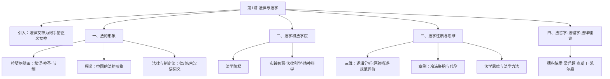
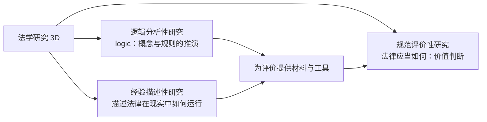

# 法理学导论 · 第1讲：法律与法学（引论、第1–4章）

> [!info] 本讲脉络
> 本讲是法理学的开门课，回答四个层层递进的问题：
> 1. **法的形象**：西方壁画中的正义女神与中国的獬豸，各自如何理解法？
> 2. **法学是什么**：从罗马法的“正义之学”到现代的“法律科学”，法学的性质经历了怎样的变化？
> 3. **法学的性质与思维**：法学研究包含哪三个维度？法律人如何思考？（以冷冻胚胎、代孕案例完整演示）
> 4. **法哲学、法理学、法律理论**：这门学科的名字本身，在中国有一段曲折的来历。

## 引入：法律女神为何把手搭在正义女神身上

雅典壁画中，法律女神（忒弥斯）将手搭在正义女神身上，这个画面提示两点：

1. **法律需借助权威运行，而不能自己运行**——法律文本是静态的，必须通过权威机构与程序才能落到现实；
2. **法律人要保持谦抑的态度**——法律之上还有正义，适用法律不能取代对正义的追问。

## 一、法的形象

### 1.1 西方：拉斐尔壁画中的正义女神

- 梵蒂冈西斯廷教堂藏有拉斐尔的壁画，画中的正义女神形象优美（课堂戏称“漂亮的小姐姐”）。
- 她所代表的正义包含三种美德：**希望、神圣、节制**。
- 这说明西方法的形象从一开始就与**美德**绑定：法不只是规则，还是善好生活的条件。

### 1.2 中国：獬豸

- 中国法的形象是神兽**獬豸**：独角，能辨是非曲直，见人相斗则触不直者。
- 古“灋”字即从獬豸，取“触不直而去之”之意。
- 与西方手持天平与宝剑的女神相比，獬豸代表的是一种**直观的、神明裁判式**的正义观。

### 1.3 “法律”与“制定法”：一个词源学考察

同一个“法”，在不同语言中承载的含义差别很大：

| 语言 | 表达 | 含义拆解 |
|---|---|---|
| 德语 | Recht | 同时指**法、权利、正确、右、直角**；译为“法权”，但在固定语境中只呈现一个含义，不产生歧义 |
| 英语 | the law / a law | the law 指整体意义上的**法体系**；a law 指**一部具体的法**；其余含义分流到 right（权利）、statute（制定法）、justice（正义） |
| 古汉语 | 灋、律、利、直 | 中国古代**没有“权利”概念**；“灋”取神兽裁判，“律”取均布划一，“利”多带贬义，“直”最接近法的观念 |

> [!note] 关键观察
> 西方一个 Recht/right 同时装下“法”与“权利”，法与权利在观念上同源；古汉语里“法”与“利（权利）”是分离甚至对立的。这种语言差异，后来深刻影响了中西方法学的走向。

## 二、法学和法学院

- **推荐教材**：优士丁尼《法学阶梯》（罗马法经典教科书）。
- 罗马法对法学的经典定义：“法学是对**神事和人事**的认识，是关于**正义与不正义**的科学。”这一定义在中世纪由教会法接续。
- 历史上对法学有三种理解，层层演进：
  1. **实践智慧（prudentia）**——jurisprudence 的本义，法是处世的明智；
  2. **知识/科学（science of law）**——近代把法学当作可体系化的客观知识；
  3. **自然/精神科学（human science）**——现代理解，法学是研究人的精神与规范世界的学问，既非自然科学也非单纯技艺。

## 三、法学性质与思维

### 3.1 法学研究的三个维度（3D）

- **逻辑分析（logic）**：拆解概念、推演规则，保证法律判断的一致性；
- **经验描述**：观察法律制度在真实社会中的运作状态，回答“法实际上是什么”；
- **规范评价**：在价值层面判断“法应当是什么”，任何法律判断最终都无法回避。

### 3.2 案例：从冷冻胚胎到代孕（2014 宜兴冷冻胚胎案 → 2026 宜兴代孕纠纷案）

> [!quote] 案例导言
> 同一个病例、同一个地点，相隔十余年上演了两版剧情：2014 年是四位失独老人争夺冷冻胚胎，2026 年演变为“小三借代孕上位”的离婚纠纷。老师用这个不断迭代的伦理难题，完整演示法学的三个维度。

#### （1）2014 年：中国首例冷冻胚胎案

**基本事实**

- 一对配子（精子、卵子）提供者夫妻，委托南京鼓楼医院通过体外受精培育出 **4 枚冷冻胚胎**，以液氮罐低温保存。
- 夫妻二人因**车祸双双去世**，留下双方父母共**四位失独老人**。
- 与医院签署保管合同的两个法律主体已经死亡；四位老人与医院之间**没有任何合同关系**。医院超期不续费，理论上可自行处理胚胎。

**各方诉求与障碍**

- 老人的真实目的是**代孕**：作为失独家庭，这是他们获得有血缘后代的最后希望，并在一审中说漏嘴“我们就是想代孕”。
- 但“代孕”二字直接触碰现行规则：国务院卫生部门的《人类辅助生殖技术管理办法》等规章**明文禁止医疗机构和医务人员实施代孕**，医院不可能交付胚胎。
- 诉讼路径几经转折：直接起诉医院→因无合同关系**不予立案**；改为四位老人互相起诉、隔代争夺，医院被列为诉讼第三人。

**两审裁判**

| 审级  | 裁判理由                                          | 结果          |
| --- | --------------------------------------------- | ----------- |
| 一审  | ①冷冻胚胎不属于可继承的**“物”**，能否作为法律客体存疑；②代孕违反卫生部门禁止性规定 | 驳回老人的主张     |
| 二审  | 进行灵活解释，**创设“保管权”和“处置权”两个新概念**，不直接套用继承规则       | 将胚胎交由四位老人处置 |

**遗留隐患**

- 判决始终没有正面回答两个核心问题：**冷冻胚胎的法律属性是什么？能不能用于代孕？**
- 事实上，事隔约一年，某省确实出现了利用相关胚胎代孕出生的子女。隐患就此埋下。

#### （2）法律维度：《民法典》如何看待冷冻胚胎

- **自然人的界限**：《民法典》规定自然人的民事权利能力**始于出生、终于死亡**。冷冻胚胎在体外、从未“出生”，因此不是民法意义上的自然人。
- **胎儿的特殊保护**：《民法典》第 16 条规定，在**遗产继承、接受赠与**等纯获利益的情形下，胎儿“**视为**具有民事权利能力”；但有一个关键但书——**胎儿出生时为死体的，其民事权利能力自始不存在**。
- “视为”是立法者的**拟制**，本质上就是一次价值判断：概念上本不相同，基于价值目的等同对待。
- 而冷冻胚胎连“胎儿”都不是（处于体外），无法被该条涵盖。
- **小结**：《民法典》基本排除了冷冻胚胎作为自然人的可能，却没有给出它“是什么”的正面定性，留下规范空白。

#### （3）医学维度：第 14 天这条界线

- 胚胎发育的**前 14 天**，细胞属于**全能细胞**：此时若有细胞脱落（自然运动、辐射等原因），脱落细胞可独立分裂、发育成另一个完整个体——因此 14 天前无法判断它将来是“一个人”还是“多个人”。
- **14 天之后**（原条形成、进入下一分裂阶段），胚胎才确定为**唯一的、特定的人类个体**，此后直至死亡，都是这一细胞群的后代。
- 但医学只能回答“代孕技术完全可行”，**无法回答“胚胎到底是不是人”**——后者属于规范与伦理问题，超出了精确科学的能力范围。

#### （4）域外参照

| 法域 | 立场与规则 |
|---|---|
| 德国 | **绝对禁止**对胚胎进行科学研究、提取胚胎干细胞、实施代孕，同时严格限制堕胎 |
| 美国·罗伊诉韦德案（1973） | 以**3 个月、6 个月**为界分级：3 个月前胚胎不具活性，女性堕胎自由；3–6 个月须在严格医疗条件下进行；6 个月后视为完整的人，丧失堕胎权 |
| 美国·现状 | 罗伊案的分级基于半个世纪前的医学认知，同时遭到反堕胎方（“无声的呐喊”纪录片）与女性权益方（社工借咨询程序拖延、变相剥夺堕胎权）的反对，约 5 年前在联邦层面被**推翻**；此后各州自行立法，规则五花八门 |

**全球代孕经济网络**（按费用分层）：

- 高端：美国（芝加哥等地，高收入人士的选择）；
- 中端：波兰、乌克兰；
- 低端：东南亚、印度。

#### （5）规范评价维度：代孕的伦理风险

- **阶级压迫的可能**：代孕可能演变为高阶群体对低阶女性的压迫——女性的子宫被异化为生育工具，胚胎的生命尊严被彻底消解。
- **中性术语的遮蔽**：讨论中使用“配子供体”“被委托方”这类词，替代了“想找人代孕的夫妻”与“出租子宫的女性”的生活事实。正如哈佛法学院的那句戏言：毕业之后，眼中再没有男人和女人，只有原告和被告——**抽象概念会抹去伦理上最关键的细节**。
- **现实价值的冲突**：当下同时存在人口焦虑、失独家庭的历史遗留问题、部分群体生育意愿低下等多重现实，规则制定必须在多方诉求间艰难平衡。

#### （6）2026 年：宜兴代孕纠纷案

- 该案正是当年冷冻胚胎案隐患的爆发：委托代孕的夫妻闹**离婚**；被委托代孕的女方反而以“**小三**”姿态上位；夫家全家倒戈，转而支持代孕女方（仅因原配无法生育）。
- **制度根源——“禁而不罚”**：现行规则只禁止医疗人员从事代孕，却**没有设置任何惩罚条款**；代孕一旦成功生育，剩下的程序仅仅是确认孩子的亲子关系，没有任何主体被追责。
- 于是代孕成为心照不宣、悄悄进行的产业；而相关纠纷仍在不断“迭代”，未来还会出现何种超出预期的新型案件，尚难预料。

> [!quote] 老师的三句关键判断
> - “硬科学、精确科学能处理的问题，不能回应规范科学和伦理学关心的更深层问题。”
> - “你要保持一种关于法律离不开价值判断的敏锐度。”
> - “隐患没有处理好，导致代孕法律禁止、但不惩罚，没有任何惩罚后果。”

#### （7）案例回扣：法律人的三种核心能力

| 能力 | 对应维度 | 如何获得 |
|---|---|---|
| 逻辑分析能力 | 分析性研究 | 本课程及各部门法课堂传授，用于概念拆解与规则推演 |
| 经验描述能力 | 经验性研究 | 课堂基本不教，须靠实习、实践项目、自主探索和对生活的观察来积累 |
| 规范评价能力 | 评价性研究 | 建立“法律离不开价值判断”的敏锐度，主动训练价值判断，不迷信冷冰冰的概念逻辑 |

> [!note] 考试提示
> 本讲内容除老师标蓝部分外，都可能成为简答题乃至大题的考点；答题时务必先辨明题干指向的维度，再结合案情展开。

### 3.3 法学思维与法学方法

**法学思维**（内在思考方式）：

- 以**论证说理**为基本方式；
- 面向**实践**，解决真实纠纷；
- **以实在法为起点**，不脱离现行法空谈；
- 坚持**问题思维**，围绕具体问题展开；
- 保持**评价性思维**，承认价值判断的位置。

**法学方法**（操作工具）：

- 法律规范命题理论；
- 案件事实的形成与法律判断；
- 法律解释；
- 法律续造（填补漏洞）；
- 法学概念与体系的建构。

## 四、法哲学、法理学、法律理论

这门学科的名称本身，在中国经历过一段反复：

| 名称 | 来历与含义 |
|---|---|
| Rechtsphilosophie | 德语“法哲学”，研究法的根本问题 |
| 法理学 | 该译名由日本学者**穗积陈重**首创，后经**梁启超**引入中国 |
| jurisprudence | 英美传统，奥斯丁（Austin）著《法理学讲义》，区分 science of jurisprudence（法理之学）与 legislation（立法之学） |
| 关于法的理学 | 当代大陆法系把法理学理解为“关于法理的学问”，带有形而上学色彩；这一表述实际上也对应凯尔森的著作名称（纯粹法学/关于法的理学） |
| 法与国家的一般理论 | 1956–1978 年间受前苏联影响使用的名称，带有明显的前苏联理论味道 |

> [!warning] 一次意味深长的改名
> 1978 年之后，学界抛弃“法与国家的一般理论”这一名称，改回“法理学”——这一改动背后，是改革开放初期急于与前苏联理论体系切割、重新接续主流法学传统的努力。学科名称的变迁，本身就是一部浓缩的学术政治史。

## 五、本讲关键概念索引

| 概念 | 一句话理解 |
|---|---|
| 法律需权威运行 | 法律不能自行运转，必须借助权威机构与程序 |
| 正义三美德 | 希望、神圣、节制（拉斐尔壁画） |
| 獬豸 | 中国神兽，触不直者，古“灋”字之源 |
| Recht | 德语同时指法、权利、正确，译“法权” |
| statute | 英语“制定法”，与整体的 the law 相对 |
| 法学阶梯 | 优士丁尼罗马法教科书，本课程推荐教材 |
| prudentia | 实践智慧，jurisprudence 的本义 |
| 法学三维（3D） | 逻辑分析、经验描述、规范评价 |
| 保管权与处置权 | 2014 冷冻胚胎案二审创设的新概念 |
| 胎儿利益拟制 | 民法典第 16 条，纯获利益时视为有权利能力，以活体出生为前提 |
| 胚胎 14 天界线 | 此前为全能细胞、可能分裂为多个体，此后确定为唯一个体 |
| 罗伊诉韦德案 | 美国 1973 年以 3 个月、6 个月分级堕胎权，约 5 年前被推翻 |
| 代孕禁而不罚 | 只禁止医疗人员代孕、无惩罚条款，是乱象的制度根源 |
| 法理学 | 穗积陈重译名，梁启超引入，1978 年后恢复使用 |
| 法与国家的一般理论 | 1956–1978 受前苏联影响的学科名称 |
