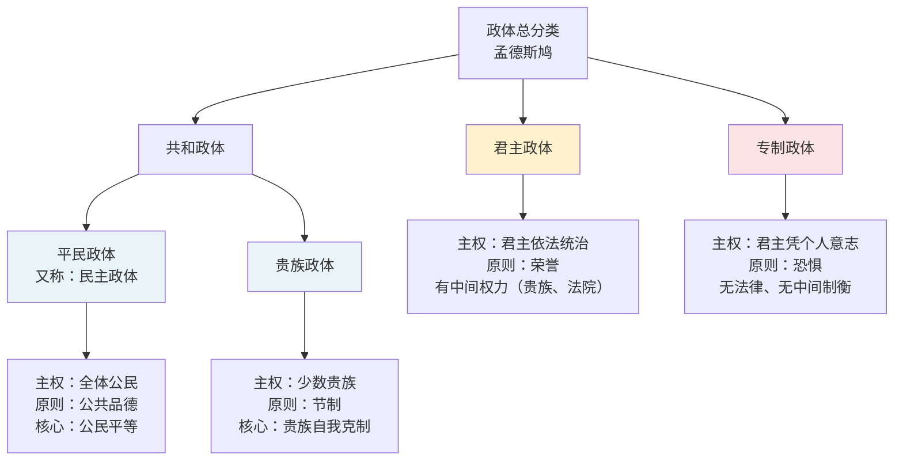

孟德斯鸠从二十岁起就开始为《论法的精神》准备材料，他把卷帙浩繁的各种有关民法的著作，做了许多条理清晰的摘录，就像当年的少年牛顿为以后使他英名不朽的那些著作打下基础一样。

# 第一章 一般意义上的法

## 第一节 法与各种存在物的关系

原文：从最广泛的意义上来说，法是源于事物本性的必然关系。就此而言，一切存在物都各有其法。
原文：存在着一个初元理性，法就是初元理性和各种存在物之间的关系，也是各种存在物之间的相互关系。

例如万有引力为天体运动提供了关系，法律道德为人与人提供相互关系等。总之，世界运动有不变的法则，“这些法则是恒定不变的关系”。并且公正关系先于人为法确立公正关系存在。

但智能世界与物质世界相比，前者不一定一直遵循这些法则，他们往往出于本性自行其是。
兽类并非凭借认知而连接在一起，所以它们没有人为法。

## 第二节 自然法

定义：先于所有法规存在的、人在社会组成之前所接受的法。
人的最初思想是保存自己，人人认为自己不如他人，**和平**成了自然法的第一条。（反对霍布斯，区分社会组成之前和社会组成之后）
人的需求是填饱肚子——自然法第二条；彼此畏惧导向亲近——第三条；获得知识、共同生活的愿望——第四条。

## 第三节 人为法

原文：人一旦生活在社会中便不再感到弱小，平等不复存在，战争状态于是就开始了。
战争促成人与人之间的法律，均描述的是关系：
- 万民法：所有国家都有
译者注：“万民法（loi des gens），又译“国际法”。万民法源自罗马法，意思是“各民族共有”的法律，适用于罗马公民和非公民之间，用以解决罗马人与异邦人以及被征服地区居民之间的各种矛盾。孟德斯鸠生活的时代迥然有异于古罗马时代，他所说的万民法比较接近“对外关系法”。”
- 政治法：政府存在的条件；格拉维纳说得对：“各种单个力量汇集起来，就组成人们所说的政治国家。”
- 公民法：格拉维纳又说，意愿的融合就是人们所说的公民国家。
法律是人类的理性；应该量身定做、与政体相吻合，同时顾及国家物质条件、气候、能承受的自由度等等因素。

# 第二章 直接源自政体性质的法

目标：探讨与政体性质相关的法律

## 第一节 三种不同政体的性质

共和政体：全体人民（民主政体）或部分人民（贵族政体）掌权
君主政体：一人执政；
专制政体：一人执政，但无法律无规则。
## 第二节 共和政体和与民主相关的法

全体人民通过选票“成为”君主。表达意见需要：
确定公民会议的公民数量；执行人由人民任命；人民需要一个参政会或参议院的指导。
大部分公民有足够的参选能力，却不具备足够的被选能力。平民从未请求担任公职。
同时，人民有能力听取管理报告，却不适宜自己管理；且人多手杂。于是划分等级+投票选举。
抽签有缺陷，因此进行审查的改进；
投票方式：公开进行还是秘密进行？
唯有人民才可立法：元老院决定+人民试行并同意。
## 第三节 与贵族政治性质相关的法

原文：元老院中实行的是贵族政治，在贵族集团中实行的是民主政治，而人民则没有任何地位。
“在君主政体中，法律服务于基本政体，或者与之相适应，政体的原则束缚着君主的手脚。可是，在共和政体中，如果一个公民攫取了过高的权力，滥用权力的情况就会更加严重，因为法律对此未曾作出预见，因而无力制止。

| 对比维度        | 罗马独裁官                  | 威尼斯国家监察官（审理官）                       |
| ----------- | ---------------------- | ----------------------------------- |
| **针对的冲突对象** | 贵族 ↔ 平民（人民）            | 贵族 ↔ 贵族（内部家族）                       |
| **政体的真正矛盾** | 捍卫贵族政体的残余，与人民对抗        | 维护贵族政体，与贵族内部反叛者对抗                   |
| **威胁的性质**   | 公开、突发（民众激愤爆发，非预谋）      | 长期、隐秘（贵族家族密谋夺权）                     |
| **存续时间**    | 短期、临时，专为某一突发事件设置       | 长期、常设的强势官职                          |
| **权力范围**    | 有限，仅限该特定事务             | 广泛，可大范围调查、预防潜在罪行                    |
| **办案方式**    | 高调、大造声势，靠公开震慑          | 隐蔽、秘密办案、广泛秘密调查                      |
| **主要目的**    | 震慑人民，而非惩罚（甚至对已招认的罪行）   | 预防人所不知的罪行，惩治被怀疑的罪行                  |
| **为何如此设计**  | 动乱是突发情绪，事件结束即收权，避免长期集权 | 阴谋会扩散（个人→家族→多家族），须长期存在才能酝酿、实施、中止、重启 |
在一个贵族政体中，与权力丝毫不沾边的人民如果又少又穷，以至于占统治地位的那些人根本无需压迫他们，那么，这就是最佳的贵族政体了。

总结：好的贵族政体，要缩小贵族与底层人民之间的差距；贵族不要压迫底层，政体越靠近民主越好；一旦贵族把人民变成私人奴隶，贵族政体就烂到极致。
因为：
1. 与权力不沾边的人很少，无需压迫；
2. 贵族要融入民众，向民主靠拢，扩大参政人群；
3. 不要把底层群体变成贵族私人奴隶，否则容易激化阶级矛盾。

## 第四节 法律与君主政体性质的关系

君主政体即单独一人依据基本法治国的政体。
有人想保护人民权力因而废除领主司法权，但结局是变为平民政体或专制政体。
即便僧侣权力对共和政体十分危险，在法律败坏、君主政体滑向专制政体之时，僧侣权力也能制止专断势力。

原文：然没有别的屏障，这个屏障那就永远是好的，由于专制政体带来了无穷无尽可怖的祸害，所以只要能遏制专制主义，即令是弊端，也是一种好东西。

原文：“海洋试图覆盖整个大地，却被岸边的小草和沙砾挡住了。与此同理，君主的权力似乎是无边无际的，但是，小小的障碍却也能遏制君主的权力，使之在民众的抱怨和恳求面前失去其天然的骄横。

君主政体还需要法律监护机构，发布法律、提醒执行。反例：君主的枢密院，朝令夕改、成员数量少、不能获得人民信任。

## 第五节 与专制政体性质相关的法律

专制政体——只有一个人行使权力——唯我独尊——不愿管理政务——将权力交付给宰相（专制政体国家基本法）

注意：“法文的专制政体（le despotique，le despotisme）的含义与中文的“专制”并不完全重合。尤其在孟德斯鸠的笔下，le despotisme始终是君主政体因腐败而蜕变成的最坏的政体，其君主即使不是暴君，也与暴君相去不远；因而，le despotisme始终是一个贬义词，不同于一般的由君主单独执政的王国和帝“国。中文的“专制”则泛指所有由君主独自掌握政权的政体，实际上包括了孟德斯鸠笔下的君主政体和专制政体。所以，严格地说，将le despotisme 译作“专制政体”是不准确的。但一则考虑到约定俗成的原则，再则也确实找不到更确切的中文术语，所以只得依旧译作“专制政体”。

# 第三章 三种政体的原则

目标：探讨与政体原则相关的法律
性质决定政体，原则推动政体。

民主政体的原则：平民政体不像君主或专制政体一样无需很多道义，它还需要美德的动力。
贵族政体：并非绝对需要美德，但也需要（贵族约束自己）
君主政体：美德绝非君主政体的原则

| 政体   | 看待犯罪的特点                       | 底层原因                                       |
| ---- | ----------------------------- | ------------------------------------------ |
| 共和政体 | 私罪≈公罪。针对个人的犯罪，**首要危害是政体**     | 共和国依靠公民品德、平等维系；人与人之间的关系就是政体根基。伤害公民，就是伤害共和国 |
| 君主政体 | 公罪≈私罪。针对国家的犯罪，**首要危害是个人（君主）** | 君主政体依托君主与荣誉；国家人格化在君主身上，侵害国家就等同于侵害君主本人      |
在君主政体中用什么取代美德？——荣宠：能激发最高贵的行动。
原文：在治理良好的君主国里，几乎每个人都是好公民，但是，好人却极为罕见，因为，要做好人，首先得想做好人，而且是为了国家而不是为了自己才爱国。
荣宠绝非专制政体原则：人人都是奴隶
专制政体的原则：需要畏惧。君主无限权力交给被委托者，需要以畏惧窒息他们造反的勇气。

“史书告诉我们，图密善骇人的恐怖行径令帕夏心惊肉跳，平民于是在他在位期间稍稍获得了一点休养生息的机遇，恰如洪流摧毁了河岸的一侧，而另一侧则幸免于灾，极目远眺，还能望见若干草场。”
**君主的恐惧、暴力，优先对准高官权贵；底层普通人反而偶尔能躲过直接迫害**。获得意外的自由（偶然结果），这并非好的政府。

服从在宽和政体与专制政体中的区别：专制政体要求绝对服从，只有宗教能够对抗君主的旨意。

# 第四章 教育法应该与政体原则相适应

教育法：原文：在君主政体中，教育法以荣宠为目标，在共和政体中，教育法以美德为目标，而在专制政体中，教育法则以畏惧为目标。

## 第二节 君主政体的教育

> 在君主政体中，主要教育并非在教育儿童的公共学校中进行，而是当人们进入社会时才在某种意义上开始。这就是人们所说的荣宠学校，而荣宠则是无处不在的指导我们的万能教师。
> 
> 在那里，人们看到并一再听到的这样三句话：“品德要高尚，作风要坦诚，举止要礼貌。”
> 
> 人们在那里向我们展示的美德，自我完善的成分总是多于施惠于人的成分，与其说是号召我们与同胞们平起平坐，毋宁说是让我们出人头地。
> 
> 在那里，对人们行为的判断不是好坏，而是美丑，不是公正与否，而是伟大与否，不是合理与否，而是非凡与否。

感受：以上这几句话一定程度上影射了现代社会。现代性的竞争与内卷一定程度上竟然符合了君主政体的荣宠原则。

> 然而，礼节的源头通常并非纯而又纯，它源自出人头地的欲望。我们讲礼貌是基于一种自尊，我们以自己的待人接物方式为荣，因为它表明我们不是卑劣之徒，不曾与历代为人所不齿的那些人为伍。

## 第三节 专制政体的教育

专制政体教育旨在降低心志，必须是奴役性的
教育窄而又窄——专制政体无教育。

## 第五节 共和政体的教育

共和政体需要教育的全部力量。
政治美德：舍弃自我、爱法律、爱祖国
父辈应当向儿童传授知识、家庭教育和爱。

> 变坏的绝不是新生的一代，只有当成年人腐化之后，他们才会堕落。

以下三节涉及有关历史的内容和专有名词较多，不易理解，由人工智能整理。

## 第六节 希腊的一些制度

**核心概括**：古希腊立法者深知，平民政体必须依靠公民品德维系，因此设计了大量反世俗常规、奇特的制度塑造公民。

- 以斯巴达莱喀古士立法为典型：克里特法律是斯巴达蓝本，柏拉图法律是其改良版本。
- 莱喀古士刻意混合矛盾事物：把偷盗与公道、严酷奴役与极端自由、残酷情感与宽厚融为一体；刻意取消财富、商业、艺术、城墙，剥离私人家庭情感，压制私人私欲，以此激发公民对城邦的热爱。
- 结论：这套制度让斯巴达长期强盛。就算敌人在战场上打赢，只要没能摧毁这套制度，胜利便毫无意义。
- 孟德斯鸠点评：希腊立法者的天才，在于敢于颠覆旧风俗，用整套制度把**公共品德**植入公民内心。

## 第七节 这些奇特的制度在什么场合是良好的

**核心概括**：希腊这套极端奇特的制度，**只适合小国共和城邦，放到大国就会失效**。

- 这种制度的本质：强行压抑人的私人欲望、牺牲个体幸福，只为服务城邦公共利益，对公民要求极高。
- 适用边界：只适合人口少、疆域狭小的共和国。小国公民视野局限，更容易把城邦当成全部；国土一大，私人利益就会膨胀，这套严苛风俗无法维持。
- 补充：这类制度不是普适良法，是**特殊政体下的特殊手段**，不能随便移植到其他国家。

## 第八节 为古人关于风俗的一个似是而非的说法进一解

**核心概括**：解答古人 “音乐能塑造民风” 这个看似奇怪的观点，论证感官教化在共和教育里的价值。

- 古人认为音乐能改良风俗，孟德斯鸠解释：体育锻炼会使人性格粗暴；纯粹理性思辨让人孤僻；**音乐是中间手段，通过感官打动心灵，柔化人的性情，缓和法律的严酷**。
- 音乐不能直接产生政治品德，但可以塑造心灵气质，为品德提供土壤；如果一个民族长期从事狩猎，性格就会变得粗野，同理，长期音乐熏陶可以柔化民风。
- 底层逻辑：共和政体教育不能只靠理性说教，还需要情感、感官层面的熏陶，以此塑造适合共和政体的公民心性。

# 第五章 立法应该符合政体原则

## 第二节 何为政治国家中的美德

——爱国。

> 修道士为什么如此热爱他们的修会？恰恰因为修会令修道士无法忍受。教规剥夺了常人感情赖以支撑的所有事物，唯一余下的便是对折磨他们的那些教规的感情。

## 第三节 何为民主政体中对共和国的爱

民主政体中：爱共和国=爱民主政体=爱平等=爱节俭
公民对国家负债与生俱来；才能不出众，家道不富庶，这是许多人明智而愉快的重要原因。

## 第四节 如何唤起对平等和节俭的爱

以此为乐=以此为爱=写进法律
结论：必须把平等和节俭写进法律

## 第五节 民主政体的法律应如何确立平等

本节讨论了关于土地、婚姻、继承等法律的制定。

民主政体下的一切不平等都源自民主政体的性质和平等原则本身。

孟德斯鸠举了古代雅典这类城邦会遇到的三个现实麻烦：

1. 穷人要打工糊口。如果让他当官，他没法干活赚钱 → 变穷；或者为了赚钱谋生，没空好好履行公职。
2. 工匠这类靠手艺谋生的人，如果拥有政治权力，容易骄傲自大，破坏城邦风气。
3. 大量被释放的奴隶取得公民身份，人数一多，力量超过老牌公民，冲击原有城邦秩序。

在这种情况下，民主政体中公民之间的平等，就可能为了维护民主而不复存在。但是，消失的仅仅是表面的平等。

为了防止上面这些风险，城邦**不得不做限制**：比如不让穷人、工匠、新解放奴隶担任高级公职。 看上去，大家不再完全平等，一部分人被剥夺部分政治权利，**表面平等没了**。 但孟德斯鸠说：**这只是表面平等消失，底层的民主内核保住了。**

## 第六节 民主政体的法律应如何保持节俭

简朴、财富的平等，这二者彼此相关，互相保持。
商贸精神必然与简朴相伴。
保持商贸精神：商贸国家中，每个人都要平等地拥有劳动权利；子女平分父辈财产。

## 第七节 维护民主原则的其他方法

- 建立元老院
- 保持旧游的习俗有利于民风
- 长幼有序
- 父权
- ……

## 第八节 贵族政体的法律应如何适应政体的原则

原文：在贵族政体下，宽和就是所谓的美德，犹如平民政体下的平等精神。
解释：贵族与平民交织在一起，平民就会忘记自己的卑微
贵族只有群体的特权，没有个人特权，否则就变成君主政体

贵族政体的纷乱之源：
1. 是治者与被治者之间的极端不平等：贵族的特权是建立在平民的羞耻之上的。
2. 公民们缴纳捐税的条件不同

原文：把财富分发给民众，这在民主政体下会产生恶劣的后果，但在贵族政体下却会产生相当良好的后果；这是一条基本规律。前者使民众丧失公民精神，后者促使民众重铸公民精神。（作者的这个观点有点违背常识）

贵族不纳税、不经商……

## 第九节 君主政体的法律应如何适应政体的原则

应当支持贵族世袭、继承人替代制、遗产赎回制……

TODO：制作第八节与第九节的对比表格

## 第十节 君主政体施政的迅捷

君主政体较之共和政体有一大优点：由于一人主事，因而施政较为迅捷。——有可能变为草率——法律应当使之放慢速度

## 第十一节 君主政体的优越性

西塞罗：“事实上，民众若是群龙无首，这股力量就更加可怕。首领知道自己肩负的责任，所以会认真思考；可是民众一旦群情激昂，就全然不知道自己正在纵身深渊。”

## 第十三节 什么是专制主义

路易斯安那的蛮人想要果子的时候，就把果树从根部砍倒，然后采摘。这就是专制政体。

## 第十四节 法律应如何适应专制政体的原则

专制政体：畏惧原则；君主可以用“昏庸”来概括。
原文：保存国家其实不过是保存君主而已，或者说只是保存君主的宫禁而已。

“说了这么多之后，人类的天性似乎将会不断地起而反对专制政体。可是，尽管人们热爱自由，憎恶暴力，大多数民族却依然屈从于专制政体之下。这不难理解。想要组成一个宽和的政府，就必须整合各种权力，加以规范和控制，使之发挥作用，并给其中的一种权力添加分量，使之能与另一种权力相抗衡。这是立法上的一件杰作，偶然性很难成就它，审慎也很难成就它。反之，专制政体则是一目了然，无论在何地，它都一模一样，只要有愿望就能把它建立起来，所以这件事谁都能干。”

## 第十六节 权力的授受

原文：在君主政体下，权力的传递不那么直接，君主在授权时对权力有所削减。他的授权有一定之规，当他把一部分权力交给别人时，必定把更大的一部分留给自己。

## 第十七节 礼物

“在共和政体下，礼物令人生厌，因为美德不需要礼物。在君主政体下，荣宠比礼物更能给人以激励。在专制政体下，荣宠和美德两者皆无，能够推动人去做些事的，唯有对舒适生活的期盼。”

